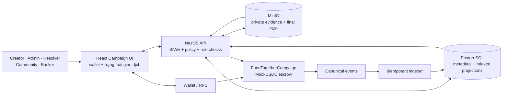
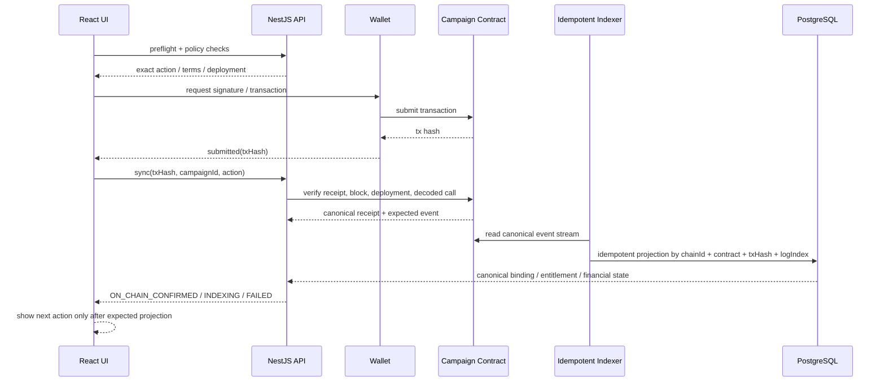
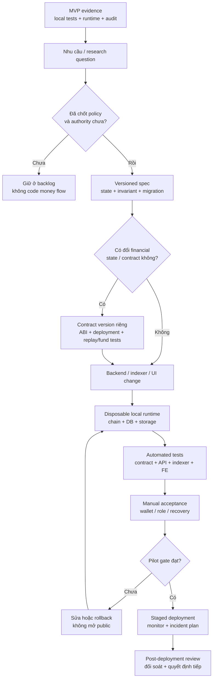

# FundTogether — Workflow hiện tại và mô hình triển khai post-MVP

> **Cập nhật:** 2026-10-17  
> **Phạm vi:** FundTogether Campaign — `COMICS_ARTBOOK`, một `STANDARD` tier, một quyền `DIGITAL_DOWNLOAD` dạng PDF.  
> **Cách hiểu:** `post-MVP` là mô hình phát triển sau khi MVP đã có workflow local có thể kiểm chứng; đây không phải tên của một runtime hoặc một deployment namespace.

Tài liệu này trả lời hai câu hỏi:

1. Một campaign hiện tại đi qua những bước nào từ lúc Creator bắt đầu cho tới completion settlement hoặc refund?
2. Khi mở rộng sau MVP, dự án phải triển khai theo các cổng kiểm soát nào để không biến một proposal thành quyền di chuyển tiền đã được bật?

## 0. Đọc trong 30 giây

### Một câu chuyện đơn giản

```text
🧑‍🎨 Creator chuẩn bị một truyện tranh/artbook PDF
        ↓
🛡 Resolver kiểm tra hồ sơ, bằng chứng và mở review cộng đồng
        ↓
🔗 Resolver + Creator kích hoạt đúng snapshot trên contract
        ↓
💳 Backer góp MockUSDC; tiền nằm trong escrow, chưa đến Creator
        ↓
📄 Creator sản xuất → Resolver duyệt evidence và PDF cuối
        ↓
📦 Creator nộp completion dossier và ký requestCompletion
🛡 Resolver xem dossier + phản hồi Backer, rồi duyệt hoặc yêu cầu sửa
✅ Resolver ký approveCompletion: goal settlement + surplus claim pool
↩️ Nếu goal fail / dispute hợp lệ / timeout: refund
```

### Tuyến đường chính của một campaign

```mermaid
flowchart LR
    A["1 · 🧑‍🎨 Chuẩn bị\nCreator + Admin"] --> B["2 · 🛡 Review\nResolver + Community"]
    B --> C["3 · 🔗 Kích hoạt\nResolver → Creator"]
    C --> D["4 · 💳 Góp vốn\nBacker → Escrow"]
    D --> E["5 · 📄 Sản xuất & PDF\nEvidence → Release"]
    E --> F["6 · ✅ Hoàn tất\nGoal + surplus settlement"]
    D -. "goal fail / cancel / timeout" .-> R["↩️ Refund"]
    E -. "challenge upheld / timeout" .-> R

    classDef prepare fill:#fff4d6,stroke:#b7791f,color:#4a2c00
    classDef review fill:#e8f1ff,stroke:#2b6cb0,color:#102a43
    classDef chain fill:#eee7ff,stroke:#6b46c1,color:#2d1b69
    classDef money fill:#e6ffed,stroke:#2f855a,color:#164e2c
    classDef end fill:#f0f0f0,stroke:#4a5568,color:#1a202c

    class A prepare
    class B review
    class C chain
    class D,E money
    class F,R end
```

```text
🟨 Chuẩn bị     🟦 Review     🟪 On-chain     🟩 Tiền / delivery     ⚪ Kết thúc hoặc refund
```

### Ai làm gì trong một dòng?

| Bước | Người chính | Kết quả dễ hình dung |
| --- | --- | --- |
| **1. Chuẩn bị** | Creator + Admin | Có một hồ sơ hợp lệ, một quyền tải PDF và một ví đã xác minh |
| **2. Review** | Resolver + Community | Hồ sơ được kiểm tra; community góp ý nhưng không bỏ phiếu thay Resolver |
| **3. Kích hoạt** | Resolver → Creator | Contract xác nhận đúng terms; lúc này mới có thể mở funding |
| **4. Góp vốn** | Backer + Contract | MockUSDC đi vào escrow; canonical event tạo entitlement |
| **5. Sản xuất** | Creator + Resolver | Evidence và PDF cuối được kiểm tra theo hash |
| **6. Kết thúc** | Contract | Payout cho Creator hoặc refund cho Backer |

### Cách đọc tài liệu này

```text
Phần đầu  = nhìn workflow như một câu chuyện sản phẩm
Phần giữa = xem state, transaction, quyền và nguồn dữ liệu
Phần cuối = biết post-MVP được mở rộng như thế nào mà không phá fund safety
```

**Bốn câu hỏi để không nhầm trạng thái:**

1. Hồ sơ đã được Resolver duyệt chưa?
2. Campaign đã có binding canonical ở `FUNDING` chưa?
3. Entitlement đã được indexer ghi nhận chưa?
4. PDF đã được Resolver duyệt và bytes có khớp hash chưa?

Chỉ khi từng câu hỏi có bằng chứng đúng lớp mới mở hành động tiếp theo.

## 1. Bản đồ nhanh

### 1.1 Kiến trúc và dòng dữ liệu



**Nguyên tắc nguồn sự thật:**

- Contract là nguồn sự thật cho pledge, escrow, deadline, dispute, refund, goal settlement và surplus claim.
- PostgreSQL lưu hồ sơ ứng dụng và projection từ blockchain; DB không tự tạo entitlement hay giao dịch tiền.
- MinIO giữ evidence và PDF riêng tư; file được chấp nhận không tự tạo settlement.
- UI chỉ hiển thị trạng thái đã được xác nhận theo đúng lớp: submitted → receipt → indexed → available.

### 1.2 Một campaign đi qua bốn trục song song

```text
HỒ SƠ  :  DRAFT → FROZEN → REVIEW → APPROVED / CHANGES_REQUESTED / REJECTED
CHAIN  :                         ACTIVATION → FUNDING → ACTIVE → RELEASED → COMPLETION_REQUESTED → COMPLETED
FILE   :                                       evidence → PDF → hash-verified download
MONEY  :                         escrow       → refund hoặc goal/surplus settlement
```

Không được gộp bốn trục này thành một trạng thái duy nhất. Ví dụ:

```text
APPROVED        ≠ đã publish on-chain
receipt         ≠ đã được index
EVIDENCE_REVIEWED ≠ đã mở download
DOWNLOAD_AVAILABLE ≠ BACKER_CONFIRMED
```

## 2. Vai trò và quyền hạn

| Vai trò | Được làm trong workflow | Không được làm |
| --- | --- | --- |
| **Creator** | Tạo draft của mình, khai báo IP, nộp sample/evidence, freeze, kích hoạt campaign bằng ví đã liên kết, nộp production evidence/PDF và completion dossier | Tự xác minh, tự duyệt campaign/release/completion, tự đổi frozen terms hoặc destination |
| **Admin** | Xác minh Creator và IP declaration ở lớp ứng dụng | Tự cấp entitlement, chuyển tiền, rebind campaign hoặc duyệt completion/claim |
| **Resolver** | Mở community review, approve/request changes/reject, duyệt production/release, xử lý dispute | Sửa frozen terms, đổi creator wallet hoặc sở hữu entitlement |
| **Community** | Xem thông tin được mở công khai và gửi `COMMENT`/`ISSUE`/`FILE_UNAVAILABLE` theo policy | Vote, pledge thay Resolver, cấp quyền tải hoặc quyết định completion/claim |
| **Backer** | Approve MockUSDC, pledge, xem entitlement, tải PDF khi đủ điều kiện, challenge/refund khi hợp lệ | Tạo entitlement không có canonical pledge, thay đổi giá hoặc terms |
| **Backend** | Auth, validation, policy gate, private storage, ticket download, sync request và projection API | Tự xác nhận payment từ request/receipt chung, giữ private key Resolver hoặc tự chuyển tiền |
| **Indexer** | Đọc event canonical, xử lý idempotent, cập nhật projection | Suy đoán payment/entitlement/settlement từ dữ liệu không có event |
| **Smart contract** | Giữ escrow và thực thi state transition tài chính | Tin vào trạng thái do client hoặc DB gửi lên |

## 3. Workflow hiện tại — từ Creator đến Backer

```mermaid
flowchart TD
    Start([Bắt đầu]) --> Auth["Creator đăng nhập SIWE\nliên kết và xác minh wallet"]
    Auth --> Draft["Tạo draft\nCOMICS_ARTBOOK + STANDARD + PDF"]
    Draft --> Evidence["Upload sample riêng tư\ncontent / budget / evidence plan"]
    Evidence --> Freeze["Freeze commitment\nrevision + snapshot hash"]
    Freeze --> PrivateReview["UNDER_REVIEW_PRIVATE\nResolver-only"]
    PrivateReview --> OpenReview["Resolver mở\nCOMMUNITY_REVIEW"]
    OpenReview --> Feedback["Community feedback\nkhông phải vote hoặc pledge"]
    Feedback --> Decision{"Resolver quyết định"}
    Decision -->|CHANGES_REQUESTED| Draft
    Decision -->|REJECTED| Rejected([Kết thúc: rejected])
    Decision -->|APPROVED| Activation["ACTIVATION_PENDING\nkiểm tra snapshot + deployment"]
    Activation --> ResolverTx["Primary Resolver ký\napproveCampaign(exact terms)"]
    ResolverTx --> CreatorTx["Creator ký\ncreateCampaign(exact terms)"]
    CreatorTx --> CanonicalCreate{"Receipt + event + indexer?"}
    CanonicalCreate -->|Chưa| Recovery["PENDING / ORPHANED / INDEXING\nreconcile, không pledge"]
    Recovery --> CanonicalCreate
    CanonicalCreate -->|Có| Funding["FUNDING\npublic pledge surface"]
    Funding --> Pledge["Backer approve MockUSDC\n→ pledge price × quantity"]
    Pledge --> Entitlement["Canonical Pledged event\n→ quantity entitlement"]
    Entitlement --> Finalize{"Hết funding deadline"}
    Finalize -->|Goal chưa đạt| Refunding["REFUNDING\nBacker claim full escrow"]
    Finalize -->|Goal đạt| Active["ACTIVE\nCreator sản xuất"]
    Active --> Production["Production evidence\n+ summary công khai"]
    Production --> EvidenceReview["Resolver review\nEVIDENCE_REVIEWED"]
    EvidenceReview --> Completion["Creator confirm completion\n+ release deadline"]
    Completion --> PDF["Upload final PDF riêng tư\nrecord PDF hash + release evidence"]
    PDF --> ReleaseReview["RELEASE_REVIEW"]
    ReleaseReview --> ReleaseDecision{"Resolver duyệt PDF?"}
    ReleaseDecision -->|Chưa| PDF
    ReleaseDecision -->|Có| Released["RELEASED\n7-day challenge window"]
    Released --> Download["Entitled Backer\ncanonical entitlement + accepted hash + bytes"]
    Released --> Challenge{"Có challenge mở?"}
    Challenge -->|Có và upheld| Refunding
    Challenge -->|Không / dismissed / hết hạn| CompletionRequest["Creator lập completion dossier\nrequestCompletion\nCOMPLETION_REQUESTED"]
    CompletionRequest --> CompletionDecision{"Resolver quyết định"}
    CompletionDecision -->|Yêu cầu sửa / từ chối| Released
    CompletionDecision -->|Duyệt đúng requestHash| Completed["COMPLETED\ngoal về frozen Creator wallet\nsurplus thành claim pool"]
    Download --> Confirm["BACKER_CONFIRMED\noptional audit feedback"]
```



### 3.1 Nhánh review hồ sơ

```text
DRAFT
  │ Creator sửa hồ sơ, upload sample, chuẩn bị plan
  ▼
FROZEN
  │ server khóa terms, wallet, tier, evidence references và commitment hash
  ▼
UNDER_REVIEW_PRIVATE
  │ Resolver xem riêng; chưa có public preview, feedback hoặc pledge
  ├── Resolver mở community review ──► COMMUNITY_REVIEW
  │                                      │ community chỉ góp ý
  │                                      ▼
  └──────────────────────────────► Resolver quyết định
                                      ├── APPROVED
                                      ├── REJECTED
                                      └── CHANGES_REQUESTED ──► DRAFT
```

`CHANGES_REQUESTED` quay về **cùng canonical campaign row**, nhưng snapshot đang review bị vô hiệu hóa và lịch sử quyết định được giữ lại. Không tạo bản ghi campaign mới chỉ để sửa hồ sơ.

### 3.2 Nhánh activation và funding

```text
APPROVED trong DB
   │ chưa đủ để cho pledge
   ▼
ACTIVATION_PENDING
   │ kiểm tra exact commitment, creator wallet, deployment và Resolver actor
   ├── binding không có ─────────────► Primary Resolver approveCampaign
   ├── binding có nhưng không canonical ► ORPHANED / recovery only
   └── receipt + canonical CampaignCreated + indexer
                                      ▼
                                   FUNDING
                                      │
                         approve MockUSDC → pledge
                                      │
                         Pledged event → entitlement
```

Một ví có thể pledge nhiều lần và mua quantity dương trong một transaction. Không có inventory cap giả tạo, không có tier phụ và không có pledge trước khi binding canonical ở state `FUNDING (0)`.

### 3.3 Nhánh production, delivery và settlement

```text
ACTIVE
  │ Creator tự sản xuất; tiền vẫn ở escrow
  ▼
PRODUCTION_EVIDENCE_SUBMITTED
  │ Resolver / backup kiểm tra đúng hash
  ├── rejected ──► Creator nộp lại ở đúng giai đoạn
  └── accepted ─► EVIDENCE_REVIEWED
                    │ Creator xác nhận completion + release deadline
                    ▼
                 RELEASE_REVIEW
                    │ Resolver kiểm file, hash và evidence
                    ├── rejected ──► nộp lại theo policy
                    └── accepted ─► RELEASED
                                      ├── download cho entitlement hợp lệ
                                      ├── challenge mở → completion bị khóa
                                      ├── ACTIVE → Creator requestDisbursement
                                      │             ├── mọi lần: kèm file giải thích sử dụng tiền
                                      │             ├── lần sau: kèm thêm bằng chứng dùng khoản trước
                                      │             └── Resolver approve/reject, không có timer cố định
                                      └── hết challenge window, không dispute → Creator requestCompletion
                                                            │
                                                            ▼
                                                     COMPLETION_REQUESTED
                                                            │ Resolver approve/reject bất cứ khi nào
                                                            ├── reject → RELEASED + revision mới
                                                            └── approveCompletion → COMPLETED
```

`COMPLETION_REQUESTED` là trạng thái on-chain thật, không phải nhãn do UI tự suy ra.
Creator gửi completion dossier private gồm tiêu đề, tóm tắt, lý do hoàn thành và
file tùy chọn; không nhập amount, destination hoặc breakdown giải ngân. `requestHash`
khóa đúng revision đó. Backer được xem hồ sơ và góp ý; Resolver có thể duyệt, từ chối
hoặc yêu cầu Creator sửa bất cứ khi nào sau khi challenge gate mở, không có timer 7
ngày riêng cho completion.

Khi Resolver duyệt request giải ngân, contract chuyển đúng amount và cộng vào
`creatorPaid`; tổng các lần giải ngân không vượt quá `goal`. Khi Resolver duyệt
completion, contract chuyển phần còn thiếu `goal - creatorPaid` tới frozen Creator wallet. Phần
`raised - goal` (nếu dương) ở lại escrow thành surplus pool. Mỗi Backer canonical
được claim đúng phần pro-rata theo số tiền đã góp; họ chọn nhận về ví hoặc tặng phần
đó cho Creator. Không có Admin destination hoặc Admin split trong MVP.

Download chỉ được mở khi đồng thời có:

```text
canonical entitlement
+ chưa refund
+ đúng account
& accepted PDF hash
& đúng deployment / release evidence
& private bytes tồn tại và khớp hash
```

URL tải chỉ là ticket backend ngắn hạn (60 giây). Hết hạn URL không làm entitlement hết hạn; refund hoặc reorg vẫn có thể chặn access khi server kiểm tra lại.

## 4. State machine tài chính

```text
                         funding deadline
                      ┌─────────────────────┐
                      │                     │
                      ▼                     ▼
FUNDING ───────────► ACTIVE ───────────► RELEASE_REVIEW
   │                   │                     │
   │ goal fail /       │ production          │ final PDF accepted
   │ cancel / timeout  │ evidence accepted  ▼
   │                   └──────────────► RELEASED
   │                                      │
   │                                      ├─ challenge upheld
   ▼                                      ├─ release timeout
REFUNDING ◄───────────────────────────────┘
   │
   ├─ Backer claim một lần → REFUNDED (theo entitlement/backer)
   │
    └─ challenge window hết hạn + zero open disputes
                                       ▼
                               COMPLETION_REQUESTED
                                       │ Creator requestCompletion
                                       │ Resolver approve/reject
                         ┌────────────┴────────────┐
                         │                         │
                    rejected                  approved
                         │                         │
                      RELEASED            COMPLETED + goal settlement
                                                    │
                                                    ├─ goal → frozen Creator wallet
                                                    └─ surplus → pro-rata Backer claims
```

### Quy tắc tiền phải giữ nguyên qua mọi lớp

```text
raised = escrowed + refunded + goalSettlement + surplusClaims
```

- Pledge và inbound token transfer phải thành công atomically; sai hoặc fail thì revert cả trạng thái.
- Refund cập nhật trạng thái trước guarded transfer; transfer fail phải revert để retry được.
- Creator request một completion dossier không kèm amount/destination; request không tự chuyển tiền.
- Chỉ Primary Resolver hoặc Backup đủ điều kiện mới approve/reject requestHash; approveCompletion chuyển đúng goal đến frozen Creator wallet.
- Phần vượt goal được giữ trong surplus pool và claim pro-rata theo canonical contribution; mỗi Backer chỉ claim một lần, chọn refund hoặc donate cho Creator.
- Completion không có timer 7 ngày riêng; Resolver quyết định khi dossier đã sẵn sàng và challenge/dispute gate đã hợp lệ.
- Backend/Admin không có quyền chuyển token.
- Download, feedback và `BACKER_CONFIRMED` không tạo ra payment, refund hoặc completion settlement.

## 5. Transaction và indexer workflow



### Trạng thái hiển thị cần phân biệt

| Trạng thái | Ý nghĩa | Hành động tiếp theo |
| --- | --- | --- |
| `READY` | Preflight đã đọc đủ dữ liệu và điều kiện đúng | Cho phép request wallet |
| `SUBMITTED` | Wallet đã trả tx hash | Theo dõi/reconcile, chưa pledge thành công |
| `RECEIPT_CONFIRMED` | Receipt thành công | Chờ kiểm event và indexer |
| `INDEXING` | Receipt có nhưng projection chưa canonical | Không tạo giao dịch trùng |
| `ON_CHAIN_CONFIRMED` | Đúng deployment, event, actor, terms và projection | Mở bước kế tiếp |
| `ORPHANED` | Có dấu vết transaction/binding nhưng chưa canonical đúng campaign | Recovery only, không pledge |
| `FAILED` | Reverted hoặc action-specific validation thất bại | Recheck trước khi retry |

Identity của event phải đủ mạnh để chống trùng và nhận diện reorg:

```text
(chainId, contractAddress, transactionHash, logIndex)
```

## 6. Ma trận dữ liệu và quyền quyết định

| Loại dữ liệu / quyết định | Nơi lưu hoặc thực thi | Tính riêng tư | Có tạo quyền tài chính không? |
| --- | --- | --- | --- |
| Creator identity / IP declaration | PostgreSQL + private storage | Private | Không |
| Frozen campaign terms / commitment | PostgreSQL + hash on-chain khi publish | Terms public từ Community Review; identity vẫn private | Chỉ khi contract nhận exact terms |
| Sample pages / production evidence | MinIO + metadata DB | Private bytes; summary có thể public | Không |
| Final PDF | MinIO private + accepted SHA-256 | Private | Không |
| Pledge / escrow / refund / completion / surplus | FundTogetherCampaign + canonical events | Chain state | Có |
| Entitlement | PostgreSQL projection từ canonical pledge | Account-bound | Có quyền download khi đủ release gate |
| Download ticket | Backend, short-lived | Private, account-bound | Không |
| Community feedback | PostgreSQL, scoped theo snapshot | `COMMENT` public ẩn danh; issue có thể private | Không |
| Review decision | PostgreSQL audit + contract action khi relevant | Role-scoped/public theo stage | Không tự tạo tiền |

## 7. Mô hình triển khai post-MVP

### 7.1 Post-MVP không phải là một feature list tự động được bật

Post-MVP bắt đầu sau khi workflow MVP/H1 đã có bằng chứng local đủ tái lập. Mỗi mở rộng phải có một **decision boundary** riêng:



### 7.2 Các cổng bắt buộc

| Gate | Câu hỏi phải trả lời | Bằng chứng tối thiểu | Nếu chưa đạt |
| --- | --- | --- | --- |
| **G0 — Scope** | Tính năng này thuộc FundTogether hay là product khác? | Scope, non-goals, role matrix | Không thêm route/schema |
| **G1 — Policy** | Ai có quyền quyết định? Điều kiện nào mở/refund/completion? | Policy version, state transition, failure rules | Không đổi contract hoặc tiền |
| **G2 — Contract** | Có cần state/ABI/deployment mới không? | Solidity tests, invariant, replay/access/reentrancy checks | Chỉ giữ proposal |
| **G3 — Sync** | Event nào là canonical và xử lý duplicate/reorg thế nào? | Event identity, idempotency tests, recovery path | Không cấp entitlement từ receipt |
| **G4 — Application** | API, DB, storage và UI có cùng boundary không? | Server validation, role checks, migration/revert plan | Không dựa vào frontend để bảo vệ policy |
| **G5 — Verification** | Luồng thành công và failure/refund có tái lập không? | Build, unit/integration, local E2E, manual matrix | Chưa gọi là implemented |
| **G6 — Pilot** | Người dùng thật, wallet thật, vận hành thật có thể xử lý sự cố không? | Runbook, logs, backup, incident/rollback plan | Chưa public hoặc real-asset launch |

### 7.3 Lộ trình post-MVP đề xuất

```text
P0  Củng cố MVP/H1
    └─ reproducible local runtime, manual wallet, recovery, audit, monitoring

P1  UX / vận hành ít rủi ro
    └─ giảm friction, dashboard, incident tooling, reporting
    └─ không thay đổi quyền sở hữu tiền nếu chưa có policy mới

P2  Contract extension có kiểm soát
    └─ version contract + ABI + indexer stream + migration + replay/invariant tests

P3  Pilot có kiểm soát
    └─ environment được phê duyệt, identity/IP thật, support và rollback

P4  Mở rộng sản phẩm
    └─ chỉ sau đánh giá pilot, policy/legal/ops và quyết định triển khai mới
```

## 8. Những hướng post-MVP và trạng thái hiện tại

| Hướng | Trạng thái | Điều kiện để xem xét |
| --- | --- | --- |
| **EIP-712 Resolver approval** | Định hướng UX, chưa triển khai | Contract version riêng; bind creator, terms, `chainId`, `verifyingContract`, nonce, expiry; có replay/expiry tests và migration plan |
| **Creator advance / progressive disbursement** | MVP hẹp: Resolver duyệt từng request khi campaign `ACTIVE`; mọi lần cần file giải thích sử dụng tiền, từ lần 2 cần thêm bằng chứng dùng khoản trước | Mở rộng milestone, exposure cap, expense reconciliation và policy chia phí vẫn deferred |
| **Funding request / expense reconciliation** | Deferred | State machine và accounting mới; không được suy ra từ `ACTIVE` hiện tại |
| **Shared refund vault / proportional refund** | Deferred | Custody, isolation, conservation invariant và recovery policy riêng |
| **Multiple tiers / bundles / inventory** | Ngoài MVP | Benefit, entitlement, pricing và contract semantics mới |
| **Physical fulfilment / shipping / merchandise** | Ngoài scope hiện tại | Product/legal/operations decision riêng; không thêm trở lại vào Campaign MVP |
| **NFT / marketplace / transferability** | Ngoài scope hiện tại | Consumer rights, transfer semantics và security review riêng |
| **Public chain / real asset / mainnet** | Chưa được authorize | Production security, legal, custody, monitoring, incident response và launch approval |

**Ranh giới quan trọng:** blueprint, interface, documentation hoặc test scaffold không đồng nghĩa với executable financial contract, deployed contract hay verified money flow.

## 9. Cách triển khai local hiện tại

### Runtime chuẩn

```text
Web             5175
API             3002
PostgreSQL      5436
MinIO           9202 / 9203
Anvil RPC       9548
Chain ID        31339
Token           MockUSDC
Manifest        .local/fundtogether/generated/campaigns-deployment.local.json
Baseline        backend/drizzle/fundtogether/0000_fundtogether_baseline.sql
```

```powershell
& .\backend\scripts\campaigns\start-services.ps1
```

Sau khi build đã được xác nhận và muốn tái sử dụng output hiện tại:

```powershell
& .\backend\scripts\campaigns\start-services.ps1 -SkipBuild
```

Local runtime là disposable. Khi reset chain/DB/storage, phải dừng API/indexer, backup state cần giữ, deploy lại Campaign + MockUSDC, chạy baseline migration rồi mới start API/web. Không dùng dữ liệu archive để nghiệm thu workflow hiện hành.

## 10. Definition of Done cho một workflow

Một workflow chỉ được báo là **implemented và verified** khi đủ các lớp sau:

```text
Policy approved
   + executable code đúng policy
   + contract / API / indexer / UI nối đúng boundary
   + success path đã test
   + failure / refund / retry / duplicate path đã test
   + local runtime evidence đã ghi
   + manual limitation đã ghi rõ
```

### Không được dùng các bằng chứng sau để kết luận quá mức

| Bằng chứng | Chỉ chứng minh được | Không chứng minh được |
| --- | --- | --- |
| Wallet request | User đã bắt đầu ký/gửi | Transaction mined hoặc pledge canonical |
| Successful receipt | Contract transaction thành công | Indexer đã tạo entitlement đúng |
| DB row | Ứng dụng có projection/metadata | Contract đã chuyển tiền |
| Accepted PDF hash | Resolver chấp nhận release evidence | Backer đã đọc hoặc completion settlement đủ điều kiện |
| Download request | Server đã cấp/nhận yêu cầu tải | Backer đã đọc/chấp nhận PDF |
| Automated local E2E | Luồng local tái lập được | Identity/IP ngoài đời, MetaMask thủ công, public launch |
| Documentation / interface | Ý định và boundary | Executable financial behavior |

## 11. Checklist vận hành ngắn

```text
[ ] Đúng Campaign namespace, chain 31339 và deployment manifest
[ ] Creator identity/IP và linked wallet đã qua đúng role gate
[ ] Snapshot/hash hiện tại khớp terms đang review
[ ] APPROVED đã phân biệt với canonical FUNDING
[ ] Mọi transaction có tx hash + expected action + reconcile path
[ ] Receipt đã được event/indexer xác nhận trước khi mở entitlement
[ ] PDF bytes và SHA-256 khớp release evidence
[ ] Download ticket account-bound và kiểm canonical state lại khi GET
[ ] Challenge/refund/completion settlement không bị trộn với download/confirmation
[ ] Nếu là post-MVP: policy, version, tests, pilot và rollback đã có
```

## 12. Tài liệu nguồn

- [Research direction](../research-direction.md) — hướng nghiên cứu và scope sản phẩm.
- [Project overview](../PROJECT_OVERVIEW.md) — kiến trúc và runtime hiện hành.
- [Campaign scope](SCOPE.md) — boundary của MVP.
- [Current workflows](WORKFLOWS.md) — state và quyền chi tiết.
- [Financial policy v1](FINANCIAL_POLICY_V1.md) — escrow, challenge, refund, goal settlement và surplus claims.
- [Campaign H1 blueprint](../architecture/CAMPAIGNS_H1_BLUEPRINT.md) — kiến trúc và các hướng deferred.
- [Project progress](../PROJECT_PROGRESS.md) — bằng chứng kiểm thử và giới hạn nghiệm thu.

