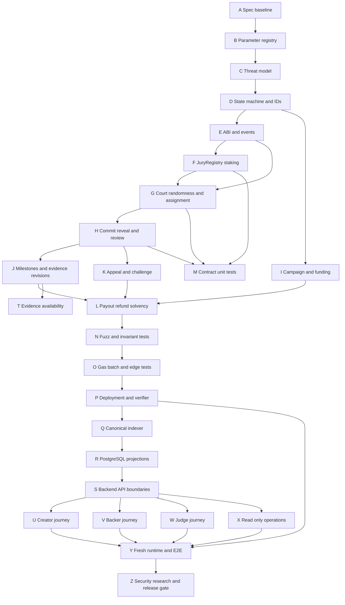

# FundTogether VNext A–Z Build Roadmap

> **For agentic workers:** REQUIRED SUB-SKILL: Use
> `superpowers:subagent-driven-development` or `superpowers:executing-plans` to
> implement this roadmap gate-by-gate. Each gate must be independently checked;
> a checked box is not runtime evidence until the referenced command or test
> produces the expected result.

**Goal:** Build and verify the pure-decentralized FundTogether VNext protocol
from policy freeze through local-chain acceptance and research evaluation.

**Architecture:** The Campaign escrow contract and Jury contracts own all
financial and review state. The backend owns SIWE, input validation, private
evidence storage and indexed projections; the indexer consumes canonical events
idempotently. The React application reads projections and submits wallet
transactions but never creates financial truth.

**Tech Stack:** Solidity, Foundry, OpenZeppelin, Anvil chain `31339`, MockUSDC,
NestJS/TypeScript, PostgreSQL/Drizzle, MinIO, React/TypeScript/Vite, Wagmi,
Viem, SIWE and existing PowerShell/Node runtime scripts.

**Spec:**
[FUNDTOGETHER_VNEXT_PROTOCOL_SPEC_V1.md](../../protocol/FUNDTOGETHER_VNEXT_PROTOCOL_SPEC_V1.md)

## Global Constraints

- Product scope is `COMICS_ARTBOOK`, one fixed-price `STANDARD` tier and one
  private `DIGITAL_DOWNLOAD` PDF.
- Any wallet may create a campaign proposal; no Resolver/Admin approval is a
  target protocol precondition.
- A reference court has exactly three unique Judges and one vote per seat.
- Stake is required for Judge participation, but stake does not multiply vote
  weight or prove real-world truth.
- V1 court validity requires all three assigned Judges to reveal on time;
  invalid/tied rounds follow retry/timeout rules.
- Review outcomes are distinct: `FINAL_PASS`, `VERDICT_FAIL` and
  `PROTOCOL_FAIL`.
- Base and Appeal Judge pools cannot overlap inside one review case.
- Payout requires the exact frozen evidence revision, final PASS, challenge
  condition and sufficient escrow; funding success alone never pays Creator.
- Creator correction cannot change the original acceptance criteria or payout
  amount and cannot continue indefinitely.
- Financial conservation is `R = P + F + E`, with payout/refund uniqueness and
  refund rights bounded by a fixed snapshot pool.
- No backend, Admin, database row, private operator key or UI status can
  override contract state or move campaign funds.
- Evidence bytes and private PDFs stay off-chain; hashes and financial
  consequences are the on-chain commitments.
- All financial amounts use integer-safe token units and `bigint`; no floating
  point arithmetic is allowed.
- Transaction state must distinguish wallet request, submitted, mined,
  canonical receipt and indexed projection.
- The pilot remains local MockUSDC/Anvil; public-chain or real-money launch is
  not part of this roadmap's acceptance.

## Dependency map



## Roadmap gates A–Z

### Gate A — Adopt the protocol baseline

**Purpose:** Make one detailed protocol document the design reference before
any contract or UI implementation starts.

**Files:**

- Read: `docs/protocol/FUNDTOGETHER_VNEXT_PROTOCOL_SPEC_V1.md`
- Read: `docs/research-direction.md`
- Read: `docs/PROJECT_OVERVIEW.md`
- Update only when a decision changes: `docs/README.md`,
  `docs/campaigns/README.md`, `GOAL.md`

**Deliverable:** A short decision record lists the active spec version,
baseline chain, product boundary and the fact that the current checkout is not
yet proof of deployment.

**Check:** Every current target document links to the same spec and does not
describe historical Resolver behavior as target authority.

- [ ] Confirm the spec version and date.
- [ ] Confirm `COMICS_ARTBOOK`, `STANDARD`, PDF and MockUSDC/Anvil scope.
- [ ] Confirm implementation residue is labeled historical or transitional.
- [ ] Run the target Markdown link audit.

### Gate B — Freeze economic and timing parameters

**Purpose:** Convert the registry's proposed values into an explicit versioned
policy before writing fund-moving code.

**Files:**

- Update: `docs/campaigns/FINANCIAL_POLICY_V2_DECENTRALIZED.md`
- Update: `docs/protocol/FUNDTOGETHER_VNEXT_PROTOCOL_SPEC_V1.md` only if the
  reference proposal changes
- Create: `docs/protocol/parameters-v1.md`

**Decisions required:**

- stake asset and decimals;
- minimum stake floor `S0` and risk coefficient mapping;
- enrollment, commit, reveal, appeal, challenge and correction windows;
- maximum retries and maximum appeal rounds;
- review service-fee source, amount and insufficient-budget behavior;
- randomness source for local mock and production-compatible design;
- all-three-reveal invalid-court rule versus any later quorum variant;
- slash rate, non-reveal penalty, reward source and dust handling;
- appeal bond and challenger eligibility;
- overfunding surplus accounting;
- evidence availability and inaccessible-evidence timeout;
- whether the first executable release uses one court or all `floor(N/3)` courts.

**Non-negotiable accounting decision:** reviewer fees are separate from Backer
contribution escrow unless the campaign commitment explicitly includes them.

**Check:** `parameters-v1.md` has no “TBD” values for the first release, every
parameter has an owner, guard, deadline, failure path and event impact, and the
policy contains a conservation example.

- [ ] Write the parameter table with units and integer representation.
- [ ] Write the policy version identifier.
- [ ] Define which parameters are campaign-frozen and which are global.
- [ ] Define whether a parameter can change between base and appeal rounds.
- [ ] Review the table against sections 5–11 and 19 of the protocol spec.

### Gate C — Threat model and abuse cases

**Purpose:** Turn accepted decentralization risks into testable adversarial
scenarios rather than silently restoring a trusted reviewer.

**Files:**

- Create: `docs/protocol/THREAT_MODEL_VNEXT.md`
- Update: `docs/protocol/parameters-v1.md` for mitigations that are actual
  policy values
- Tests later: `contracts/test/invariant/`

**Required scenarios:** Sybil wallet concentration, court collusion, bribery
after reveal, Judge no-show, unavailable evidence, randomness timeout, appeal
pool exhaustion, fee underfunding, duplicate payout, duplicate refund,
front-running of eligible calls, failed ERC20 transfer and indexer replay.

**Check:** Each scenario states attacker capability, affected asset/state,
expected protocol result, accepted limitation and test owner. The document does
not claim that staking proves truth or one wallet equals one person.

- [ ] Map every threat to a state transition or invariant.
- [ ] Mark which risks are accepted by design.
- [ ] Mark which risks must fail closed.
- [ ] Add one acceptance test name for each high-impact financial scenario.

### Gate D — Canonical state machine and identifiers

**Purpose:** Define the only legal lifecycle before contracts, indexer and UI
choose their enums.

**Files:**

- Create: `docs/protocol/STATE_MACHINE_VNEXT.md`
- Create: `contracts/src/campaigns/VNextTypes.sol`
- Create: `contracts/src/jury/JuryTypes.sol`
- Test: `contracts/test/unit/VNext/StateMachine.t.sol`

**Required identifiers:** `campaignId`, `milestoneId`, `evidenceRevision`,
`reviewCaseId`, `roundId`, `courtId`, `judgeAddress`, `policyVersion` and
`randomnessRequestId`.

**Required states:**

```text
Campaign: CREATED → FUNDING → FUNDED → MILESTONES_RUNNING
  → COMPLETED | REFUNDING | REFUND_SETTLED

Review: EVIDENCE_SUBMITTED → ENROLLMENT → ASSIGNED
  → COMMIT → REVEAL → PROVISIONAL_RULING → APPEAL_WINDOW
  → FINAL_PASS | VERDICT_FAIL | PROTOCOL_FAIL

Judge seat: AVAILABLE → CASE_LOCKED → ASSIGNED → COMMITTED → REVEALED
  → FINAL_SETTLEMENT → REWARD/SLASH → UNLOCK
```

**Check:** Every transition has actor, guard, deadline, event, failure result
and whether it can be called by any permissionless caller. There is no
Resolver-only transition in the target state machine.

- [ ] Write the state table before Solidity implementation.
- [ ] Add invalid-transition tests for every terminal state.
- [ ] Freeze identifier encoding for vote commitments and event keys.

### Gate E — Contract interfaces and canonical events

**Purpose:** Define stable contract boundaries before implementing behavior.

**Files:**

- Create: `contracts/src/campaigns/CampaignEscrowVNext.sol`
- Create: `contracts/src/jury/JuryRegistry.sol`
- Create: `contracts/src/jury/JuryReview.sol`
- Create: `contracts/src/interfaces/IVNextEvents.sol` if an event interface is
  useful
- Update: `docs/protocol/STATE_MACHINE_VNEXT.md`

**Interfaces produced:**

- campaign creation, contribution, funding finalization, evidence revision,
  milestone payout, refund opening and Backer refund claim;
- Judge deposit, enrollment, reservation, withdrawal and reward claim;
- snapshot finalization, court assignment, vote commit/reveal, round aggregate,
  appeal opening and final ruling;
- permissionless timeout/finalization calls.

**Canonical events:** Use the event names from protocol section 14 and include
campaign, milestone, revision, case, round and court identifiers wherever a
review event can otherwise collide.

**Check:** Every function that can move funds has explicit preconditions,
postconditions, caller rules, replay guard and event. No contract accepts an
arbitrary review result from a caller or unconfigured contract.

- [ ] Write ABI/event table first.
- [ ] Check event field types against indexer key requirements.
- [ ] Check all amounts are `uint256`/token units and no floating point exists.
- [ ] Reject an interface that requires an unbounded loop for settlement.

### Gate F — Implement JuryRegistry staking

**Purpose:** Implement stake custody and reservation without mixing it with
Backer contribution escrow.

**Files:**

- Implement: `contracts/src/jury/JuryRegistry.sol`
- Implement: `contracts/src/jury/JuryTypes.sol`
- Test: `contracts/test/unit/VNext/JuryRegistry.t.sol`

**Required behavior:** Deposited/available/locked accounting, case reservation,
conflict flags, Base/Appeal pool membership, withdrawal only from available
stake, one reservation per seat and claimable reward/slash balances.

**Check:** Enforce:

```text
Deposited = Available + Locked
Withdrawable <= Available
sum(case reservations) <= Deposited
```

- [ ] Write failing tests for over-reservation and early withdrawal.
- [ ] Implement the smallest reservation/settlement flow.
- [ ] Test failed ERC20 transfer leaves state unchanged.
- [ ] Test duplicate settlement cannot slash or reward twice.
- [ ] Run `forge test --match-path test/unit/VNext/JuryRegistry.t.sol -vv`.

### Gate G — Implement snapshot, randomness and court assignment

**Purpose:** Make Judge selection verifiable and independent from backend
choice.

**Files:**

- Implement: `contracts/src/jury/JuryReview.sol`
- Create if needed: `contracts/src/jury/MockRandomness.sol`
- Test: `contracts/test/unit/VNext/CourtAssignment.t.sol`
- Test: `contracts/test/fuzz/VNextCourtAssignment.t.sol`

**Required behavior:** Freeze eligible addresses, locked case stake, pool,
snapshot block/time and randomness request. Form `K = floor(N / 3)` courts in
the configured mode, with exactly three unique assigned addresses per court.

**Check:** For N = 2, 4, 8, 9, 30 and 300, assignment is unique, deterministic
for the same mock seed, and does not slash unassigned Judges. Backend cannot
choose an address or silently replace a Judge after voting starts.

- [ ] Test creator exclusion.
- [ ] Test a Judge cannot receive two seats in one round.
- [ ] Test Base/Appeal pool non-overlap.
- [ ] Test randomness timeout follows `PROTOCOL_FAIL` policy.
- [ ] Measure gas for the largest supported local batch.

### Gate H — Implement commit–reveal review

**Purpose:** Implement the cryptographic vote lifecycle and court validity.

**Files:**

- Implement: `contracts/src/jury/JuryReview.sol`
- Create: `contracts/src/jury/VoteCommitment.sol` if hashing needs isolation
- Test: `contracts/test/unit/VNext/CommitReveal.t.sol`

**Commit preimage:** chain ID, protocol version, campaign, milestone, evidence
revision, case, round, court, Judge address, vote and salt.

**Required behavior:** Commit hides plaintext vote; reveal matches the preimage;
wrong salt, wrong Judge, reused commitment, late commit and late reveal fail;
all three reveals are required for a valid V1 court; court aggregate is PASS,
FAIL or invalid; ties go to retry.

- [ ] Write failing tests for every invalid reveal path.
- [ ] Test commitment cannot be replayed in another round.
- [ ] Test one Judge cannot commit twice unless policy explicitly permits it.
- [ ] Test no plaintext vote is emitted during commit.
- [ ] Run focused Foundry tests and inspect emitted events.

### Gate I — Implement permissionless campaign and funding escrow

**Purpose:** Replace Resolver publication authority with a campaign commitment
and contract-owned contribution ledger.

**Files:**

- Implement: `contracts/src/campaigns/CampaignEscrowVNext.sol`
- Test: `contracts/test/unit/VNext/CampaignCreation.t.sol`
- Test: `contracts/test/unit/VNext/FundingEscrow.t.sol`
- Update only after parity: `backend/scripts/campaigns/deploy-isolated.cjs`

**Required behavior:** Any wallet creates a frozen proposal; terms include goal,
deadline, payout wallet, milestone commitments, protocol version and policy
parameters; Backer contributions enter escrow; goal failure opens full refund;
funding success does not release funds.

- [ ] Test creator cannot change frozen terms after funding starts.
- [ ] Test contribution ledger is canonical and emits `ContributionReceived`.
- [ ] Test funding finalization is idempotent.
- [ ] Test ERC20 transfer failure reverts the entire action.
- [ ] Test no Resolver/Admin address can approve or move funds.

### Gate J — Implement milestone evidence and revisions

**Purpose:** Bind each payout to a specific frozen commitment and evidence
revision.

**Files:**

- Implement: `contracts/src/campaigns/CampaignEscrowVNext.sol`
- Update: `backend/src/modules/campaigns/schemas/campaign.schema.ts`
- Create/update: `backend/src/modules/campaigns/schemas/milestone.schema.ts`
- Test: `contracts/test/unit/VNext/MilestoneEvidence.t.sol`

**Required behavior:** Evidence submission anchors hash/revision, review case
identity is unique per revision, correction cannot edit acceptance criteria or
payout amount, and a paid milestone cannot be resubmitted.

- [ ] Test same revision cannot create a second payout right.
- [ ] Test a revision cannot point to another campaign/milestone.
- [ ] Test correction allowance and deadline.
- [ ] Test `VERDICT_FAIL` can correct only while policy allows it.
- [ ] Test `PROTOCOL_FAIL` follows terminal policy instead of infinite retry.

### Gate K — Implement appeal and permissionless challenge

**Purpose:** Make provisional outcomes contestable without reusing the same
Judge pool and without giving a centralized resolver a veto.

**Files:**

- Implement: `contracts/src/jury/JuryReview.sol`
- Update: `contracts/src/campaigns/CampaignEscrowVNext.sol`
- Test: `contracts/test/unit/VNext/Appeal.t.sol`
- Test: `contracts/test/unit/VNext/ChallengeWindow.t.sol`

**Required behavior:** appeal requester authorization, bond/fee funding,
appeal deadline, maximum rounds, fresh pool snapshot, no Judge overlap,
accepted appeal opens a new review, and challenge window is separate from
appeal finality.

- [ ] Test Base Judge cannot enter Appeal.
- [ ] Test Appeal Judge cannot enter the next Appeal round.
- [ ] Test accepted appeal does not itself reverse the verdict.
- [ ] Test expired challenge window permits only the exact eligible payout.
- [ ] Test upheld challenge blocks payout and follows refund/correction policy.

### Gate L — Implement payout, refund and solvency

**Purpose:** Close every fund-moving path with conservation and uniqueness.

**Files:**

- Implement: `contracts/src/campaigns/CampaignEscrowVNext.sol`
- Create: `contracts/src/campaigns/RefundMath.sol` if arithmetic needs isolation
- Test: `contracts/test/unit/VNext/PayoutRefund.t.sol`
- Test: `contracts/test/fuzz/VNext/Conservation.t.sol`

**Payout guard:** funding success, exact evidence revision, `FINAL_PASS`, no
active appeal/challenge, milestone unpaid, budget available, campaign not
terminal/refunding and sufficient escrow.

**Refund guard:** fixed snapshot pool, canonical Backer contribution, claim
uniqueness and successful transfer before marking paid. For partial settlement:

```text
RefundPool = R - P
Refund_i = floor(RefundPool * contribution_i / R)
```

- [ ] Test `R = P + F + E` after every successful financial transition.
- [ ] Test payout cannot exceed Goal or milestone budget.
- [ ] Test two payout transactions yield one success.
- [ ] Test two refund claims yield one success.
- [ ] Test rounding dust never exceeds RefundPool.
- [ ] Test funding failure refunds full confirmed contribution.

### Gate M — Contract unit and transition tests

**Purpose:** Establish behavior-level coverage before fuzzing or integration.

**Files:**

- Test: `contracts/test/unit/VNext/*.t.sol`
- Preserve historical tests: `contracts/test/unit/Campaigns/HistoricalCampaignFundingAndFulfillment.t.sol`

**Required test groups:** campaign creation, freeze, funding, snapshot,
assignment, commit/reveal, court aggregate, appeal, correction, payout,
refund, timeout, failed transfer, unauthorized caller and duplicate action.

- [ ] Run focused VNext unit suite.
- [ ] Run existing historical contract suite separately.
- [ ] Confirm historical tests are not counted as VNext evidence.
- [ ] Record gas snapshots for supported single-court flow.

### Gate N — Fuzz and invariant tests

**Purpose:** Prove the protocol's fund and identity invariants across generated
sequences.

**Files:**

- Create: `contracts/test/invariant/VNextCampaignInvariant.t.sol`
- Create: `contracts/test/invariant/VNextJuryInvariant.t.sol`
- Create: `contracts/test/fuzz/VNextStateMachine.t.sol`

**Invariants:** I1 conservation, I2 milestone payout uniqueness, I3 payout
authorization, I4 stake coverage, I5 Judge uniqueness, I6 court integrity, I7
slash bound, I8 finality, I9 refund solvency and I10 terminal liveness.

- [x] Run `forge test --match-path test/invariant/VNext*.t.sol -vvv`.
- [x] Run fuzz tests with a recorded seed and configured depth.
- [x] Include arbitrary caller, repeated caller and deadline-jump sequences.
- [ ] Save failing seeds as regression tests, never lower the invariant.

### Gate O — Gas, batching and edge-case hardening

**Purpose:** Ensure multi-court behavior can settle without unbounded loops or
unusable gas costs.

**Files:**

- Update: `contracts/src/jury/JuryReview.sol`
- Update: `contracts/src/campaigns/CampaignEscrowVNext.sol`
- Test: `contracts/test/unit/VNext/BatchSettlement.t.sol`
- Update: `docs/protocol/parameters-v1.md` with measured limits

**Required behavior:** batch court finalization, pull-claim rewards/refunds,
bounded arrays, no external callback reentrancy and safe handling of 300-judge
simulation input.

- [x] Measure one, two, ten and configured maximum courts.
- [x] Test partial batch completion and retry.
- [x] Test a caller cannot claim another wallet's refund or reward.
- [x] Review all external token calls and state-update ordering.
- [x] Record a supported local limit instead of claiming unlimited scale.

### Gate P — Deployable artifacts and runtime verifier

**Purpose:** Make contract identity, chain and bytecode verifiable before the
backend or frontend consumes them.

**Files:**

- Create/update: `backend/scripts/campaigns/deploy-vnext.cjs`
- Create/update: `backend/scripts/campaigns/verify-vnext-runtime.cjs`
- Update: `backend/scripts/campaigns/runtime-identity.cjs`
- Update: `backend/scripts/campaigns/deploy-isolated.cjs`
- Create: `backend/scripts/campaigns/vnext-runtime-identity.test.cjs`

**Required manifest:** chain ID, RPC, deployment block, contract addresses,
bytecode/code hash, ABI version, policy version, MockUSDC address and genesis
identity.

- [ ] Deploy from fresh Anvil genesis.
- [ ] Verify every address and code hash from RPC.
- [ ] Verify the manifest is not silently overwritten by a different chain.
- [ ] Run the artifact and runtime identity tests.
- [ ] Preserve old deployments as historical; do not reuse their addresses as
  VNext evidence.

### Gate Q — Canonical event indexer

**Purpose:** Project only canonical contract events and make replay safe.

**Files:**

- Update: `backend/src/indexer/campaign-indexer.service.ts`
- Update/create: `backend/src/indexer/vnext-indexer.service.ts`
- Update: `backend/src/database/schema/indexer.schema.ts`
- Test: `backend/src/indexer/tests/vnext-indexer.integration.spec.ts`

**Required behavior:** decode every VNext event, use a stable event identity,
handle reorg/confirmation policy, preserve block/log ordering, and process
duplicates idempotently. The indexer must not infer payout from vote rows.

- [ ] Index campaign, contribution, snapshot, assignment, commit/reveal,
  ruling, appeal, revision, payout and refund events.
- [ ] Replay the same block range twice with identical projection.
- [ ] Test missing/late events do not create false financial state.
- [ ] Test canonical receipt before projection status.
- [ ] Run the focused Jest integration test.

### Gate R — Database projections and read models

**Purpose:** Store searchable metadata and derived protocol state without making
PostgreSQL authoritative.

**Files:**

- Update: `backend/src/database/schema/campaigns.schema.ts`
- Update: `backend/src/database/schema/campaign-core.schema.ts`
- Update: `backend/src/database/schema/indexer.schema.ts`
- Create migration under the existing backend migration directory
- Test: corresponding schema/indexer tests

**Required projections:** campaign commitment, milestones, evidence revisions,
review cases, Judge assignments, vote lifecycle visibility, final ruling,
appeal, payout, refund claim and transaction lifecycle.

- [ ] Add uniqueness constraints for campaign/milestone/revision/case/round.
- [ ] Add indexes for canonical event identity and wallet queries.
- [ ] Keep financial amounts as integer/bigint-compatible values.
- [ ] Mark projections stale or pending when indexer confirmation is absent.
- [ ] Run migration and rollback/forward checks in an isolated database.

### Gate S — Backend API and authority boundaries

**Purpose:** Keep NestJS useful without allowing API routes to become protocol
authority.

**Files:**

- Update: `backend/src/modules/campaigns/controllers/campaign.controller.ts`
- Update: `backend/src/modules/campaigns/controllers/chain.controller.ts`
- Create/update: `backend/src/modules/campaigns/controllers/judge.controller.ts`
- Update: `backend/src/modules/campaigns/services/campaign.service.ts`
- Create/update: `backend/src/modules/campaigns/services/jury.service.ts`
- Update: `backend/src/modules/campaigns/schemas/*.ts`
- Test: `backend/src/modules/campaigns/tests/vnext-http.spec.ts`

**Required behavior:** server validation, SIWE session boundary, canonical state
reads, transaction preparation and recovery. API may prepare or relay a
transaction, but cannot approve a campaign, resolve a case, release escrow or
refund a Backer from a database mutation.

- [ ] Remove target financial gates that depend on Resolver/Admin roles.
- [ ] Return submitted/mined/canonical/indexed states separately.
- [ ] Authorize private dossier reads from canonical assignment or creator
  ownership, not a decorative role label.
- [ ] Test forged wallet addresses and forged review results.
- [ ] Run the focused backend Jest suite.

### Gate T — Evidence availability and private storage

**Purpose:** Make evidence review reproducible while stating the limits of a
hash correctly.

**Files:**

- Update: existing MinIO/storage module under `backend/src`
- Create/update: evidence hash/revision service under
  `backend/src/modules/campaigns`
- Test: evidence storage/hash/retrieval tests
- Update: `docs/protocol/THREAT_MODEL_VNEXT.md`

**Required behavior:** private upload, immutable revision metadata, SHA-256 or
specified hash, authenticated short-lived access, availability check and
clear distinction between byte integrity and factual truth.

- [ ] Test hash mismatch cannot create a valid evidence revision.
- [ ] Test an expired/private ticket cannot retrieve the file.
- [ ] Test inaccessible evidence follows timeout/retry policy.
- [ ] Test a revision hash cannot be changed after case enrollment.

### Gate U — Creator journey

**Purpose:** Give Creator a complete permissionless proposal and milestone
submission flow.

**Files:**

- Update: `frontend/src/features/campaigns/creator/`
- Update: `frontend/src/features/campaigns/shared/FrozenTerms.tsx`
- Update: `frontend/src/features/campaigns/shared/ui/TransactionLifecycle.tsx`
- Create/update: milestone evidence and correction components
- Test: `frontend/scripts/campaigns-creator-vnext.test.mjs`

**Required behavior:** freeze terms, show commitment hash/policy version,
submit evidence revision, show court enrollment/reveal/final ruling, submit
bounded correction and show exact payout eligibility. Creator cannot approve
their own case from the UI.

- [ ] Test all transaction lifecycle labels.
- [ ] Test acceptance criteria and payout cannot be edited after freeze.
- [ ] Test `PROTOCOL_FAIL` is explained as operational failure.
- [ ] Test correction limit/deadline in the UI.

### Gate V — Backer journey

**Purpose:** Make contribution, milestone observation, challenge and refund
recoverable and canonical.

**Files:**

- Update: `frontend/src/features/campaigns/public/`
- Update: `frontend/src/features/campaigns/backer/`
- Update: `frontend/src/features/campaigns/shared/detail/CampaignLedger.tsx`
- Update: `frontend/src/features/campaigns/transactions/`
- Test: `frontend/scripts/campaigns-backer-vnext.test.mjs`

**Required behavior:** show frozen commitment, escrow, milestone case status,
review phase, challenge/appeal eligibility, canonical pledge and own refund
claim. Funding success must never be shown as Creator payout.

- [ ] Test wallet-submitted versus mined/indexed pledge.
- [ ] Test a Backer cannot claim another Backer's refund.
- [ ] Test partial refund uses snapshot-derived amount.
- [ ] Test private PDF access is separate from financial settlement.

### Gate W — Judge journey

**Purpose:** Expose staking, assignment and commit–reveal without implying
that a UI action alone resolves a case.

**Files:**

- Update: `frontend/src/features/campaigns/judge/JudgeConsole.tsx`
- Update: `frontend/src/features/campaigns/judge/JudgePublicationPanel.tsx`
- Create/update: Judge stake, enrollment, commit/reveal and settlement panels
- Update: `frontend/src/features/campaigns/shared/ui/StatusBadge.tsx`
- Test: `frontend/scripts/campaigns-judge-vnext.test.mjs`

**Required behavior:** show eligible stake, locked case stake, assigned court,
commit deadline, reveal deadline, reveal status, final settlement and reward or
slash projection. A Judge sees only assigned dossier access.

- [ ] Test conflict/creator exclusion display.
- [ ] Test commit hides vote until reveal.
- [ ] Test wrong-phase and wrong-case actions are blocked.
- [ ] Test no `PASS` label before canonical court finalization.

### Gate X — Read-only operations, history and observability

**Purpose:** Keep infrastructure operations useful while removing decision
authority from operational surfaces.

**Files:**

- Update: `frontend/src/features/campaigns/admin/AdminConsole.tsx`
- Update: `frontend/src/features/campaigns/admin/CampaignOperationsPage.tsx`
- Update: backend operational/indexer health controllers
- Update: `docs/PROJECT_PROGRESS.md`
- Test: `frontend/scripts/campaigns-vnext-operations.test.mjs`

**Required behavior:** show RPC, indexer lag, failed events, storage health,
deployment identity and retryable operational actions. No action approves,
rejects, pays, refunds or overrides a case.

- [ ] Test no Admin control can create a final ruling.
- [ ] Test historical Resolver pages are visibly historical or removed from the
  target navigation.
- [ ] Test operational retry does not mutate financial state directly.
- [ ] Record metrics needed for finality latency and review completion.

### Gate Y — Fresh local runtime and end-to-end acceptance

**Purpose:** Prove the complete vertical slice against a fresh disposable
Anvil/PostgreSQL/MinIO runtime.

**Files:**

- Update/create: `backend/scripts/campaigns/start-chain.ps1`
- Update/create: `backend/scripts/campaigns/start-services.ps1`
- Update/create: `backend/scripts/campaigns/deploy-vnext.cjs`
- Update/create: `backend/scripts/campaigns/migrate-isolated.cjs`
- Create: `backend/scripts/campaigns/vnext-scenarios-e2e.cjs`
- Create: `backend/scripts/campaigns/vnext-browser-e2e.cjs`
- Create: `backend/scripts/campaigns/vnext-runtime-identity.test.cjs`

**Required scenario:** fresh genesis → deploy MockUSDC and VNext contracts →
migrate DB → seed separate Creator/Backer/Judge wallets → create campaign →
form court → commit/reveal → fund → submit evidence → final PASS → challenge
window → payout → next milestone → terminal failure → pro-rata refund.

**Required failure scenarios:** no quorum, tie, appeal, correction,
`PROTOCOL_FAIL`, failed transfer, duplicate payout, duplicate refund, indexer
replay and unavailable evidence.

- [ ] Archive prior disposable runtime state before reset.
- [ ] Verify chain ID `31339`, deployment block, code identity and manifest.
- [ ] Verify service ports: web `5175`, API `3002`, PostgreSQL `5436`, MinIO
  `9202/9203`, RPC `9548`.
- [ ] Run contract, backend, indexer and browser acceptance sequentially.
- [ ] Confirm all financial outcomes from canonical events, not UI state.

### Gate Z — Security, research evaluation and release decision

**Purpose:** Decide whether the local VNext prototype is reproducible and
research-ready without claiming public-chain safety.

**Files:**

- Update: `docs/PROJECT_PROGRESS.md`
- Create: `docs/protocol/VNEXT_RELEASE_REPORT.md`
- Create: `docs/protocol/VNEXT_EXPERIMENT_RESULTS.md`
- Update: `docs/research-direction.md` only with measured evidence

**Security review:** contract access control, reentrancy, replay, integer
rounding, stake reservation, duplicate settlement, randomness assumptions,
Sybil concentration, collusion, bribery, liveness, evidence availability,
unbounded gas and indexer duplication.

**Research baselines:** immediate payout, centralized Resolver, flat majority,
multi-court hierarchical majority, slashing and appeal. Measure false PASS/FAIL,
attack success, review completion, finality latency, gas, cost per case, locked
capital, reward inequality, refundable proportion and invariant violations.

**Release gate:**

- [x] `forge test` unit, fuzz and invariant suites pass.
- [x] Backend focused Jest suite passes with VNext tests separated from historical tests.
- [x] Frontend VNext scripts pass.
- [ ] Fresh runtime E2E passes twice from clean state.
- [x] Indexer replay is idempotent.
- [ ] No unresolved financial invariant violation exists.
- [x] Known accepted risks and unsupported limits are recorded.
- [x] Report says “local research prototype verified” only if evidence supports
  it; never “trustless truth” or “public-chain ready” by implication.

## Milestone gates and release order

```text
M0  A–D  Spec, parameters, threats, state machine frozen
M1  E–H  Jury contracts and review lifecycle pass focused tests
M2  I–L  Campaign escrow, milestones, appeal, payout and refund pass invariants
M3  M–P  Contract suite and verified deployment artifacts complete
M4  Q–T  Canonical indexer, projections, API and evidence boundaries complete
M5  U–X  Creator, Backer, Judge and read-only operations complete
M6  Y     Fresh local-chain vertical acceptance complete
M7  Z     Security/research report and release decision complete
```

A later milestone cannot be accepted by compensating with a database flag or
manual Admin action. If a gate fails, keep funds in escrow or follow the
already-frozen terminal policy; do not add a Resolver shortcut.

## Definition of Done for the whole roadmap

The roadmap is complete only when all of the following are true:

1. The implemented contract state matches the versioned protocol policy.
2. Every fund movement is authorized by canonical contract state.
3. `R = P + F + E` holds across generated and end-to-end sequences.
4. Payout, refund, Judge position, vote, appeal and evidence revision cannot be
   settled twice.
5. Base and Appeal Judge pools are non-overlapping and court membership is
   verifiable.
6. The indexer can replay canonical events without duplicate financial claims.
7. The backend and Admin surface cannot manufacture a ruling or move funds.
8. The UI distinguishes transaction lifecycle, projection state and canonical
   finality.
9. Fresh local runtime acceptance is reproducible on chain `31339`.
10. Research results report both benefits and accepted Sybil/collusion/liveness
    limitations.

## Explicit non-goals

- public-chain deployment;
- real-money launch;
- KYC or one-human identity proof;
- physical fulfilment, shipping or inventory;
- NFT/marketplace expansion;
- reintroducing Resolver/Admin financial authority;
- treating evidence hashes, Judge majority or stake as proof of real-world
  truth.
